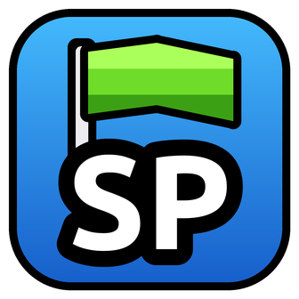

# SP Creator

A [Geode](https://geode-sdk.org) mod for Geometry Dash 2.2091 (Windows). For Geometry Dash 2.2081, use
[v0.9.0](https://github.com/Zekrom1221/sp-creator/releases/tag/v0.9.0).

[По-русски](README.ru.md) · [Telegram channel](https://t.me/spcreator_gd) (news and updates, in Russian)

Place your own startpos (SP) in any classic level while you play: online levels, main levels and your own.
Starting from it replays a short auto part (0.6 s by default) before you take control, so you enter the hard part
at full speed and with the right camera, the way you'd get there from the level start. The auto part plays back
your own run, and you can't die in it. Platformer levels have no SPs.

Attempts from your SPs count in the attempt counter, like attempts from any startpos, but they don't save a new
best or a completion.

Found a bug, or have an idea? [Open an issue](https://github.com/Zekrom1221/sp-creator/issues)
or [write to the Telegram channel](https://t.me/spcreator_gd?direct).

## Installing

1. Install [Geode](https://geode-sdk.org) for Geometry Dash 2.2091.
2. Download `zekrom.sp-creator.geode` from [Releases](https://github.com/Zekrom1221/sp-creator/releases).
3. Put it into the `geode/mods` folder in the game's folder (in Steam: right-click Geometry Dash → Manage →
   Browse local files), and start the game.

The mod needs Node IDs. If Geode says it's missing, install it from Geode's mod list.

### Coming from v0.9.0

Your SPs of v0.9.0 (Geometry Dash 2.2081) are brought over to this game version the first time you enter each
level, and the mod says how many. `.spcreator` files exported with v0.9.0 import too. This goes one way: the SPs
as they were stay in the `levels-2.2081` folder next to the mod's `levels` folder, just in case.

## Keys

| Key | What it does |
| --- | --- |
| `V` | Place an SP where you are |
| `,` and `.` | Previous / next SP (or the level start) |
| `Delete` | Delete the SP you start from |

The game's own keys *Start Pos: Previous* and *Start Pos: Next* (in its keybinds, no keys by default) go through
your SPs too.

The **SP** button in the pause menu lists your SPs: play from one, rename, delete one or several at once. The
clock button there sets the auto part length.

## Settings

In the mod's settings:

- the keys, and *SP switcher keys*: the mod's own SP switcher (the `,` and `.` keys) on or off;
- *Auto part length*;
- *Block control in the auto part*: on, your clicks in the auto part do nothing; off, a click there gives you
  control right away;
- *Hide the level's startposes* and *Notice about the level's startposes* (see "With other mods");
- *SP storage* and the language.

## Your SPs

- SPs are saved between sessions, for each level. They only fit the level version, game version and Low Detail
  Mode they were made with.
- **Sharing.** In the SP list, **Export** saves the SPs you pick to a `.spcreator` file. **Import** opens such a
  file: **Add** adds its SPs to yours, and **Replace all** puts them in place of yours (**Save and replace** keeps
  yours as a version, **Delete and replace** deletes them). Import files only from people you trust. A
  `.spcreator` file is only data: a file that asks to be run, or comes as an `.exe`, is not a `.spcreator` file,
  so don't open it.
- **Versions** in the SP list keeps SPs you put aside: replaced by an import, deleted with **Save and delete**,
  or left from before a level update. Open a version to bring its SPs back, rename it, or delete it. Nothing is
  deleted on its own. If a version already has the same SPs, they aren't saved again: that version moves to the
  top.
- **Level updates.** When a level is updated, your SPs are moved over to the new version. An SP that needs
  objects the update took away stays in **Versions** only: the message shows its percent, so you can place it
  again.
- **Your own levels.** If you change even one object of your own level (move, add or delete it, in the editor or
  with the game's **+** button on the pause menu, which adds a startpos), its SPs aren't moved over: the level
  starts with no SPs, and the old ones stay in **SP storage**, where you can delete them. Saving it without
  changes keeps its SPs.
- **SP storage** in the mod's settings lists the SPs and versions of all levels, the biggest first, so you can
  delete what you don't need.

## With other mods

- **The level's own startposes** are hidden from other mods and from the game's own startpos list, so they see
  only your SPs. The level still starts where it does. A notice on entering the level tells you so. To see them
  everywhere, turn off *Hide the level's startposes* in the settings, then enter the level again: then the mod's
  `,` and `.` go through them too.
- **The game's own startpos list** on the pause menu (its arrows and list) shows your SPs by their names: *SP 3
  (8.2%)*, or the name you gave one, as in *Ship part (8.2%)* (Latin letters only: other names show as *SP 3*).
- **Startpos switchers** (Mega Hack, Eclipse) list your SPs. An SP placed in the current visit goes to the end of
  their list (and of the game's own startpos list) until you enter the level again. After you delete or replace
  SPs, their list may keep a few extra places until then: picking one takes you on to the next SP (or to the level
  start). The mod's own switcher (`,` and `.`) doesn't need you to enter the level again: it goes through all your
  SPs in order right away, the new ones too.
- **Mega Hack** (checked with 9.2.0-beta.3): its switcher uses the game's own startpos list and keys
  (*Setup Keybinds* opens the game's keybinds). *Smart StartPos* can stay on: SPs start the way you placed them.
- **Eclipse** (checked with 1.10.1): its switcher lists your SPs by their names, as the game's own list does. If
  a level had no SPs when you entered it, Eclipse's switcher may not be there until you enter the level again.
  Give its switcher keys of its own: on the game's *Start Pos: Previous / Next* keys or on the mod's `,` and `.`,
  one press moves two SPs instead of one, since both switch.
- **Globed** (checked with 2.3.0): SPs work with other players in the level too.
- With **Physics Bypass** (Mega Hack, Eclipse), SPs play the same at any tick rate.
- **Blitzkrieg** (checked on Geometry Dash 2.2081; not out for 2.2091 yet) makes stages of your SPs. After adding
  or deleting SPs, create a new profile with *Bind profile* on: editing a profile keeps its old startposes.

## Known issues

- Where a level's gameplay is rotated or goes back (up the screen, or to the left), SPs are in the order of where
  they stand, not of their percent: there the SP list and the `,` and `.` keys can go back and forth. Mega Hack's
  switcher orders them the same way.
- SPs placed with Low Detail Mode on in one of your own levels (a copy of another level, say) may not import for
  someone else: they get *These SPs are for Low Detail Mode off: turn it off* or *These SPs are for another
  version of this level*. Until this is fixed, place and import such SPs with Low Detail Mode off on both sides.
- SPs placed on a screen of another shape (16:9 and 16:10, say) start with the camera a little to the side: it
  slides to its place during the auto part.
- While the file window of **Export** or **Import** is open, don't click the game: in full screen the window
  goes behind it, and clicking the game doesn't bring it back. If that happens, right-click the game on the
  taskbar and pick *Close window*: the game stays open, and the file window comes back.

## Building

With the [Geode SDK](https://docs.geode-sdk.org) 6.0.0 (`GEODE_SDK` set), the Geode CLI, Visual Studio with
its C++ tools, CMake and Ninja:

```
cmake -B build -G Ninja -DCMAKE_BUILD_TYPE=RelWithDebInfo -DSPC_SMOKE=OFF
cmake --build build
```

`build.bat` does the same with the paths of the author's PC. The mod is `build/zekrom.sp-creator.geode`: copy it
into the game's `geode/mods` folder.
`-DSPC_SMOKE=ON` (`build.bat smoke`) builds in a smoke test for development; release builds don't have it.

## License

Copyright (C) 2026 Zekrom. SP Creator is free software under the GNU GPL v3: see [LICENSE](LICENSE).

The mod saves SPs with the game's own checkpoints and compresses them with [zlib](https://zlib.net) (zlib
License). SPs of v0.9.0 were saved with [PersistenceAPI](https://github.com/0x5abe/PersistenceAPI) (GPLv3): the
mod reads that format to bring them over.
The mod's font is Ubuntu Bold, under the [Ubuntu Font Licence](resources/fonts/UFL.txt).
