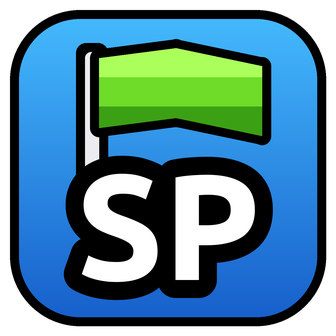

# SP Creator

Мод для Geometry Dash 2.2091 (Windows) на [Geode](https://geode-sdk.org). Для Geometry Dash 2.2081 —
[v0.9.0](https://github.com/Zekrom1221/sp-creator/releases/tag/v0.9.0).

[In English](README.md) · [Канал в Telegram](https://t.me/spcreator_gd) (новости и обновления)

Ставь свои стартпосы (SP) прямо во время игры в любом классическом уровне: в онлайн-уровнях, в уровнях игры и в
своих. Когда стартуешь с SP, сначала идёт короткая авто-часть (по умолчанию 0,6 с), а потом управление переходит
к тебе. Так ты влетаешь в сложное место на полной скорости и с нужной камерой, как при игре с начала уровня.
Авто-часть — повтор твоего же прохода, умереть в ней нельзя. В платформерах SP нет.

Сделай свою стартпос-версию уровня прямо в нём самом: не нужно искать стартпос-копию среди уровней игры или по
разным каналам. Пройди уровень в практике и поставь SP там, где нужно. Если сложный момент далеко от SP, поставь
ещё один прямо перед ним, а когда натренируешь, удали его. Тренируешься и проходишь уровень в одном месте, в
оригинале: не надо переключаться между копией со стартпосами и уровнем. Попытки с SP идут в счётчик попыток
этого же уровня, так что складывать попытки из разных копий не придётся. Как и с любого стартпоса, новый рекорд
и прохождение с SP не засчитываются.

Есть баг или идея? [Создай issue](https://github.com/Zekrom1221/sp-creator/issues) или
[напиши в Telegram-канал](https://t.me/spcreator_gd?direct).

## Установка

1. Поставь [Geode](https://geode-sdk.org) для Geometry Dash 2.2091.
2. Скачай `zekrom.sp-creator.geode` в [Releases](https://github.com/Zekrom1221/sp-creator/releases).
3. Положи его в папку `geode/mods` в папке игры (в Steam: правый клик по Geometry Dash → Управление →
   Просмотреть локальные файлы) и запусти игру.

Моду нужен ещё мод Node IDs. Если Geode пишет, что его не хватает, поставь его из списка модов Geode.

### Если у тебя была v0.9.0

Твои SP из v0.9.0 (Geometry Dash 2.2081) переносятся на эту версию игры при первом входе в каждый уровень, и мод
пишет, сколько перенесено. Файлы `.spcreator`, сохранённые в v0.9.0, тоже импортируются. Перенос — в одну
сторону: SP в прежнем виде остаются в папке `levels-2.2081` рядом с папкой `levels` мода, на всякий случай.

## Клавиши

| Клавиша | Что делает |
| --- | --- |
| `V` | Поставить SP там, где ты сейчас |
| `,` и `.` | Предыдущий / следующий SP (или старт уровня) |
| `Delete` | Удалить SP, с которого ты стартуешь |

Клавиши самой игры *Start Pos: Previous* и *Start Pos: Next* (в её настройках клавиш, по умолчанию не
назначены) тоже ходят по твоим SP.

Кнопка **SP** в меню паузы открывает список твоих SP: играть с любого, переименовать, удалить один или сразу
несколько. Кнопка с часами там меняет длину авто-части.

## Настройки

В настройках мода:

- клавиши и *SP switcher keys* — включить или выключить свитчер SP самого мода (клавиши `,` и `.`);
- *Auto part length* — длина авто-части;
- *Block control in the auto part*: включено — нажатия в авто-части ничего не делают; выключено — нажатие там
  сразу отдаёт тебе управление;
- *Hide the level's startposes* и *Notice about the level's startposes* (см. «С другими модами»);
- *SP storage* (Хранилище SP) и язык.

## Твои SP

- SP сохраняются между запусками игры, для каждого уровня свои. Они подходят только к той версии уровня, версии
  игры и режиму Low Detail Mode, с которыми были поставлены.
- **Обмен.** В списке SP **Экспорт** сохраняет выбранные SP в файл `.spcreator`. **Импорт** открывает такой файл:
  **Добавить** добавляет его SP к твоим, а **Заменить все** ставит их вместо твоих (**Сохранить и заменить**
  оставляет твои версией, **Удалить и заменить** удаляет). Импортируй файлы только от тех, кому доверяешь. Файл
  `.spcreator` — это просто данные: если файл просит его запустить или это `.exe`, то это не файл `.spcreator`,
  не открывай его.
- **Версии** в списке SP хранят отложенные SP: заменённые импортом, удалённые через **Сохранить и удалить** или
  оставшиеся от прошлой версии уровня. Открой версию, чтобы вернуть её SP, переименуй или удали. Сами по себе
  версии не удаляются. Если такие же SP уже есть в какой-то версии, второй раз они не сохраняются: эта версия
  поднимается наверх.
- **Обновление уровня.** Когда автор обновляет уровень, твои SP переносятся на новую версию. SP, которому нужны
  убранные обновлением объекты, остаётся только в **Версиях**: в уведомлении будет, на каком проценте он стоял,
  чтобы поставить его заново.
- **Свои уровни.** Если поменять в своём уровне хоть один объект (сдвинуть, добавить или удалить — в редакторе
  или кнопкой **+** самой игры в меню паузы, которая добавляет стартпос), его SP не переносятся: уровень
  начинается без SP, а старые остаются в **Хранилище SP**, там их можно удалить. Сохранение без изменений SP не
  трогает.
- **Хранилище SP** (*SP storage* в настройках мода) показывает SP и версии всех уровней, самые большие сверху:
  там можно удалить ненужное.

## С другими модами

- **Стартпосы самого уровня** скрыты от других модов и от списка стартпосов самой игры: там только твои SP.
  Уровень стартует там же, где и раньше. Об этом говорит подсказка при входе в уровень. Чтобы видеть их везде,
  выключи *Hide the level's startposes* в настройках и перезайди в уровень: тогда по ним работают и клавиши `,`
  и `.` мода.
- **Список стартпосов самой игры** в меню паузы (её стрелки и список) показывает твои SP по именам: *SP 3
  (8.2%)* или имя, которое ты дал, например *Ship part (8.2%)* (только латиница: другие имена видны как *SP 3*).
- **Свитчеры стартпосов** (Mega Hack, Eclipse) показывают твои SP. SP, поставленный в этом заходе, у них (и в
  списке стартпосов самой игры) в конце списка, пока не перезайдёшь в уровень. После удаления или замены SP в их
  списке до перезахода могут остаться лишние места: такое место ведёт к следующему SP (или на старт уровня).
  Свитчеру самого мода (`,` и `.`) перезаход не нужен: он сразу идёт по всем SP по порядку, и по новым тоже.
- **Mega Hack** (проверено с 9.2.0-beta.3): его свитчер берёт список и клавиши стартпосов самой игры
  (*Setup Keybinds* открывает настройки клавиш игры). *Smart StartPos* можно не выключать: SP стартуют так, как
  ты их ставил.
- **Eclipse** (проверено с 1.10.1): его свитчер показывает твои SP по именам, как список самой игры. Если при
  входе в уровне не было ни одного SP, свитчера Eclipse может не быть, пока не перезайдёшь в уровень. Дай
  свитчеру Eclipse свои клавиши: на клавишах *Start Pos: Previous / Next* самой игры или на `,` и `.` мода одно
  нажатие сдвигает на два SP, а не на один, потому что переключают оба.
- **Globed** (проверено с 2.3.0): SP работают и когда в уровне другие игроки.
- С **Physics Bypass** (Mega Hack, Eclipse) SP играются одинаково при любой частоте физики.
- **Blitzkrieg** (проверено на Geometry Dash 2.2081; под 2.2091 его пока нет) делает из твоих SP этапы. После
  добавления или удаления SP создай новый профиль с включённым *Bind profile*: при редактировании профиль
  оставляет старые стартпосы.

## Известные проблемы

- Там, где геймплей уровня повёрнут или идёт назад (вверх по экрану или влево), SP идут по тому, где они стоят, а
  не по процентам: в списке SP и на клавишах `,` и `.` там порядок может скакать. Свитчер Mega Hack упорядочивает
  их так же.
- SP, поставленные с включённым Low Detail Mode в твоём уровне (например, в копии чужого уровня), у другого
  человека могут не импортироваться: мод пишет «Эти SP без Low Detail Mode: выключи его» или «Эти SP для другой
  версии этого уровня». Пока это не исправлено, ставь и импортируй такие SP с выключенным Low Detail Mode у обоих.
- SP, поставленные на экране другой формы (например, 16:9 и 16:10), стартуют с камерой чуть в стороне: она
  доезжает на место за время авто-части.
- Пока открыто окно выбора файла для **Экспорта** или **Импорта**, не кликай по игре: в полноэкранном режиме
  окно уходит за неё, и клик по игре его уже не возвращает. Если так вышло, нажми правой кнопкой по значку игры
  на панели задач и выбери *Закрыть окно*: игра не закроется, а окно выбора файла вернётся.

## Сборка

Нужны [Geode SDK](https://docs.geode-sdk.org) 6.0.0 (с переменной `GEODE_SDK`), Geode CLI, Visual Studio с
инструментами C++, CMake и Ninja:

```
cmake -B build -G Ninja -DCMAKE_BUILD_TYPE=RelWithDebInfo -DSPC_SMOKE=OFF
cmake --build build
```

`build.bat` делает то же самое с путями компьютера автора. Мод — `build/zekrom.sp-creator.geode`: скопируй его
в папку `geode/mods` игры. `-DSPC_SMOKE=ON` (`build.bat smoke`) собирает мод с автотестом для разработки; в
релизных сборках его нет.

## Лицензия

Copyright (C) 2026 Zekrom. SP Creator — свободная программа под GNU GPL v3: см. [LICENSE](LICENSE).

SP сохраняются чекпоинтами самой игры и сжимаются через [zlib](https://zlib.net) (лицензия zlib). SP из v0.9.0
были сохранены через [PersistenceAPI](https://github.com/0x5abe/PersistenceAPI) (GPLv3): мод читает этот формат,
чтобы их перенести.
Шрифт мода — Ubuntu Bold, по [Ubuntu Font Licence](resources/fonts/UFL.txt).
