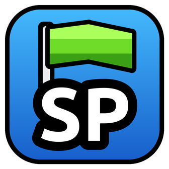

# SP Creator

Мод для Geometry Dash 2.2081 (Windows) на [Geode](https://geode-sdk.org).

[In English](README.md)

Ставь свои стартпосы (SP) прямо во время игры в любом уровне: онлайн-уровнях, уровнях игры и своих. Со старта
с SP сначала идёт короткая авто-часть (по умолчанию 0,6 с), а потом управление переходит к тебе. Так ты
влетаешь в сложное место на полной скорости и с нужной камерой, как при игре с начала уровня. Авто-часть —
повтор твоего же прохода, умереть в ней нельзя.

Попытки с SP идут в счётчик попыток, как попытки с любого стартпоса, но новый рекорд и прохождение не
засчитываются.

**Это бета.** Есть баг или идея? [Пиши в Issues](https://github.com/Zekrom1221/sp-creator/issues).

## Установка

1. Поставь [Geode](https://geode-sdk.org) для Geometry Dash 2.2081.
2. Скачай `zekrom.sp-creator.geode` в [Releases](https://github.com/Zekrom1221/sp-creator/releases).
3. Положи его в папку `geode/mods` в папке игры (в Steam: правый клик по Geometry Dash → Управление →
   Просмотреть локальные файлы) и запусти игру.

Моду нужны ещё два мода: PersistenceAPI (от sabe) и Node IDs. Если Geode пишет, что какого-то не хватает,
поставь его из списка модов Geode.

## Клавиши

| Клавиша | Что делает |
| --- | --- |
| `V` | Поставить SP там, где ты сейчас |
| `,` и `.` | Предыдущая / следующая SP (или начало уровня) |
| `Delete` | Удалить SP, с которой ты стартуешь |

Кнопка **SP** в меню паузы открывает список твоих SP: играть с любой, переименовать, удалить. Клавиши, длина
авто-части, считаются ли твои нажатия в авто-части и язык меняются в настройках мода.

Только классические уровни: в платформерах SP нет.

## Твои SP

- SP сохраняются между запусками игры, для каждого уровня свои. Они подходят только к той версии уровня, версии
  игры и режиму Low Detail Mode, с которыми были поставлены.
- **Обмен.** В списке SP **Экспорт** сохраняет выбранные SP в файл `.spcreator`, а **Импорт** добавляет SP из
  такого файла в уровень или ставит их вместо твоих (твои сохраняются версией или удаляются, как выберешь).
  Импортируй файлы только от тех, кому доверяешь. Файл `.spcreator` — это просто данные: если файл просит его
  запустить или это `.exe`, то это не SP.
- **Версии** в списке SP хранят отложенные SP: заменённые импортом или оставшиеся от прошлой версии уровня.
  Открой версию, чтобы вернуть её SP, переименуй или удали. Сами по себе версии не удаляются.
- **Обновление уровня.** Когда автор обновляет уровень, твои SP переносятся на новую версию. SP, которой нужны
  убранные обновлением объекты, остаётся только в **Версиях**: в уведомлении будет, на каком проценте она
  стояла, чтобы поставить её заново. Это для онлайн-уровней: после правки своего уровня его SP не переносятся,
  и уровень начинается без SP (старые остаются в **SP storage**).
- **SP storage** в настройках мода (окно «Хранилище SP») показывает SP и версии всех уровней, самые большие
  сверху: там можно удалить ненужное.

## С другими модами

- **Свитчеры стартпосов** (Startpos Switcher, Mega Hack) показывают твои SP вместе со стартпосами уровня. SP,
  поставленная в этом заходе, у них в конце списка, пока не перезайдёшь в уровень. После удаления или замены SP
  в их списке до перезахода могут остаться лишние места: они ведут на начало уровня.
- **Mega Hack**: на рейтинговых уровнях его свитчер выключен, пока не включишь *Allow Rated* в настройках
  StartPos Switcher.
- **Blitzkrieg** делает из твоих SP этапы. После добавления или удаления SP создай новый профиль с
  включённым *Bind profile*: при редактировании профиль оставляет старые стартпосы.

## Известные проблемы

- Там, где геймплей уровня повёрнут или идёт назад, SP идут по тому, где они стоят, а не по процентам: в списке
  SP и на клавишах `,` и `.` там порядок может скакать. Свитчер Mega Hack упорядочивает их так же.

## Сборка

Нужны [Geode SDK](https://docs.geode-sdk.org) 5.11.2 (с переменной `GEODE_SDK`), Visual Studio с инструментами
C++, CMake и Ninja:

```
cmake -B build -G Ninja -DCMAKE_BUILD_TYPE=RelWithDebInfo -DSPC_SMOKE=OFF
cmake --build build
```

`build.bat` делает то же самое с путями компьютера автора и ставит мод в игру. `-DSPC_SMOKE=ON`
(`build.bat smoke`) собирает мод с автотестом для разработки; в релизных сборках его нет.

## Лицензия

[GPLv3](LICENSE). SP сохраняются через [PersistenceAPI](https://github.com/0x5abe/PersistenceAPI) (GPLv3).
Шрифт мода — Ubuntu Bold, по [Ubuntu Font Licence](resources/fonts/UFL.txt).
